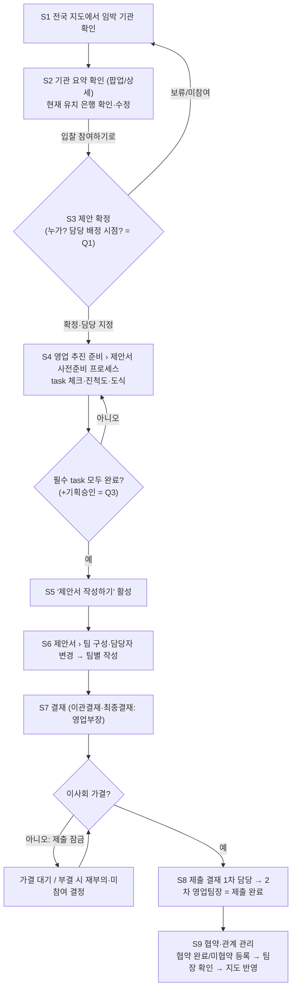

# planner 보고서 (자동 보존)

> SubagentStop 훅이 에이전트의 최종 메시지를 그대로 저장했다(2026-11-10 1542 KST, agentId a821154f199e87aea). 에이전트 출력이므로 사용자 결정이 아니다. 지시 내용·주제는 이 파일에 없다 — 필요하면 handoff/NEXT.md 항목이나 커밋 메시지로 찾는다.

---

# 기획 보고: 2026-11-10 현업 시나리오의 업무 흐름 정리 (NEXT 65)

## 1. 대상·방법·못 본 것
- **읽은 것**
  - `handoff/agents/history/2026-11-10_현업의견표_시나리오_원문.md` 전문
  - 내 앞선 분석 `handoff/agents/planner/2026-11-10_1517_a350e9d7.md`
  - PM 정리 `handoff/agents/pm/2026-11-10_1527_a2a1454e.md`(66~68 신설안 포함)
  - `PRODUCT.md`, `frontend/js/nav.js` 전문, `frontend/js/workflow.js` 9단계 정의
  - NEXT 33·54·55·56·57·59·61·65
- **못 본 것**
  - 서버 `OrchNode`·`BidCaseController`는 이번에 다시 열지 않았고 1517 보고의 인용을 그대로 썼다.
  - 6단계 '세부기획(3팀)'의 3팀이 어떤 팀인지(영업·전산·재무인지)는 코드로 확인하지 않았다. **확인 필요**
  - 019 최초 배정을 누가 하는지(영업팀장만인지)도 확인하지 않았다. **확인 필요**
  - RFP 붙임서류 목록과 발표 스크립트 양식은 실물이 없다.

## 2. 요구 요약
**확정된 전제(다시 열지 않는다)**
- 규칙 6개에 동의했다: 배정이 곧 권한이다. 영업팀 역할이라고 기본으로 열어 주지 않는다. 이사회 자료는 담당자 외 비공개이고 영업부장은 열람할 수 있다. 게이트 승인은 영업부장만 한다. (원문 1절)
- 보류는 현행 유지이고 019·020·021은 계속한다. 입찰 결과는 '선정 은행·기간+공고 근거, 지도 반영, 담당자 작성+팀장 확인'이다. (원문 2절)
- 이사회 순서: RFP 확인 → 사내 승인 → 수익성 확정 → 이사회 안건. 가결 전 기획은 막지 않고, **가결 전 제출은 불가**다. 제출은 1차 담당·2차 영업팀장이고 예외 해제는 없다. (NEXT 59, 11-09)
- 이사회 자료 규칙(NEXT 66, 11-10)
  - 작성본은 담당자 전원이 공유한다.
  - 제출하면 잠기고 담당자가 회수할 수 있다.
  - 팀장 승인이 최종 확정이다.
  - 의결 결과는 담당자가 바꿀 수 있다.
- 재무 검토 저장 범위는 'S1 값만 저장'으로 답했다(NEXT 61 Q2).
- 메뉴 이름 변경: 영업 기획 → '영업 추진 준비'(원문 3절, 사용자 명시). 제안서 관리와 제안서 작성은 한 대분류로 합치고 소분류로 나눈다.

**새로 정할 것**
- '제안 확정'을 누르는 사람과 담당 배정의 시점
- '제안서 작성하기'를 켜는 조건
- 파일 원본 보관 범위
- '팀별 작성'에서 말하는 팀이 무엇인지
- 실물 3종: 붙임서류 목록, 스크립트 양식, 기관장 프로필 항목

## 3. 전체 흐름도

| # | 단계 | 누가 | 무엇을 | 완료 조건 → 다음으로 넘어가는 조건 | 기존 9단계 |
|---|---|---|---|---|---|
| S1 | 지도 확인 | 영업 계열 누구나 | 입찰이 다가온 기관을 지도·목록에서 찾는다 | 기관을 선택한다 | 1 입찰현황 파악 |
| S2 | 기관 요약 확인 | 영업팀(전체 확인. 뜻은 Q2) | 팝업 또는 상세 화면에서 기관 정보·임직원 수·현재 유치 은행을 보고, 없으면 은행을 수정(출처 포함) | '확인'의 의미가 정해져야 판단할 수 있다 | 2 입찰상황 발생 |
| S3 | **제안 확정** | **미정(Q1)** | 이 기관 입찰에 들어가기로 정한다 | 버튼을 누르거나 결재가 끝나면 입찰 건이 생기고 **담당이 정해진다(Q1)** | 2 → 3 |
| S4 | 제안서 사전준비 프로세스 | 배정된 담당자 | 할 일(task)을 수행하고 체크한다. 진척도와 도식을 본다 | 필수 task를 모두 마친다(완료 판정은 Q3) | 3 RFP 공시·4 RFP 분석·5 기획(+이사회 꼬리표) |
| S5 | '제안서 작성하기' 켜짐 | 담당자(승인 끼움 여부는 Q3) | 작성 단계로 넘어간다 | 버튼을 누른다 | 5 기획승인 게이트 후보 |
| S6 | 제안서(관리+작성) | 담당자, 팀 구성·담당자 변경 | 팀 구성·배정·변경(019 화면), 팀별 작성 | 팀별로 작성 완료(팀 뜻은 Q5) | 6 세부기획(3팀) |
| S7 | 결재 | 영업부장(게이트), 1차 담당·2차 팀장(제출) | 취합·검토 결재, 제출 결재 | 이관결재·최종결재를 통과하고 **이사회 가결**까지 끝난다 | 7 취합·8 검토 |
| S8 | 제출 완료 | 영업팀 담당자가 누르고, 1차 담당·2차 팀장이 결재 | 사내 제출 기록(021) | 2차 승인이 나면 제출 완료 | 9 제출 |
| S9 | 협약·관계 관리 | 담당자가 등록하고 팀장이 확인 | 제출 완료 건 목록에서 협약 완료/미협약을 등록한다. 선정 은행·기간·근거를 적고 지도에 반영 | 팀장이 확인하면 끝 | (9단계 뒤, 신규) |



## 4. 사전준비 task 후보 (시나리오에 나온 것만)

| # | task(시나리오 표현) | 시작 조건 / 선행 | 완료 판정 후보 | 근거 |
|---|---|---|---|---|
| T0 | 현재 유치 은행 확인·수정 | **제안 확정 전(S2)** | 은행·출처·확인일 입력 또는 '미확인' | 원문 3절. task가 아니라 확정 전에 하는 확인 |
| T1 | 기관 정보 요약 작성 | 제안 확정 직후 | 요약서 저장(A4 2쪽 규격, NEXT 56) | 원문 1·3절 |
| T2 | 기관장 프로필 작성 | T1과 병행. 법원이면 인물별 여러 명 | 프로필 저장 | 원문 1·2·3절 |
| T3 | 수익성 분석표 업로드 | 병행 가능. **'확정본'이어야 T5 시작** | 확정본 파일 지정 | 원문 3절, NEXT 59 11-09 순서 |
| T4 | RFP 등록 → 붙임서류 업로드·체크 | **RFP가 등록됐을 때**(조건부, 병행) | 목록 항목 모두 체크 | 원문 1·3절 |
| T5 | 이사회 자료 작성 | T3 확정 뒤(필수 선행). T1·T2를 바탕으로 함(참고 선행) | **Q3**: 작성 확정(팀장 승인) / 가결 | 원문 3절, NEXT 66 |
| T6 | 이사회 발표 스크립트(정형 대본) | T5 뒤 | 대본 생성·저장 | 원문 1·3절 |

- 11-09 순서에 있는 '사내 승인'은 시나리오에 없다. 그래서 task로 만들지 않았고 Q3에서 함께 묻는다.
- **요건: task 목록은 늘어날 수 있어야 한다.** 사용자가 "더 필요한 task는 추가"한다고 했다.
  - 과제를 하나 더해도 화면·서버를 고치지 않고 붙일 수 있어야 한다.
  - task마다 담을 것: 이름, 순서, 선행 task, 필수/선택, 시작 조건, 완료 판정 방식(직접 체크인지, 파일·승인 같은 사실로 자동 판정인지), 체크한 사람·시각.
  - 진행 중인 건에 새 task를 더했을 때 그 건에도 적용할지는 2차 질문이다.

## 5. 기존 시스템과의 매핑·충돌

| # | 충돌·맞물림 | 내용 | 권장 방향 |
|---|---|---|---|
| M1 | **제안 확정과 배정의 순서** | 시나리오는 팀 구성·담당자 변경을 S6(작성)에 둔다. 그런데 S4의 이사회 자료는 담당자 외 비공개다(규칙 1·4·5). 확정 때 아무도 배정되지 않으면 **사전준비를 할 사람이 없다**. | 확정할 때 영업 담당을 지정한다. S6의 '팀 구성'은 019 배정 화면을 그 자리에 다시 보여 주는 것(추가·변경). Q1에서 묻는다. |
| M2 | **제안 확정과 참여 결정 3단 결재** | 서버에는 참여 결정 결재(영업팀 → 팀장 → 부장)가 이미 있다. '협약 대상 선정'은 '빼도 됨'으로 평가됐다. | 제안 확정 = 참여 결정 흐름의 결과로 볼지 Q1에서 함께 묻는다. |
| M3 | **9단계와 게이트** | S4가 3·4·5단계에 걸친다. 게이트(기획승인·이관결재·최종결재)는 넘어가도 되는지의 승인이고, task 체크는 했는지의 표시라 **다른 개념**이다. 기획승인을 S5 직전에 둘지가 미정이다. | 단계 번호는 바꾸지 않는다(동결). 진척도는 9단계 위에 덧붙이는 보기로 둔다. Q3 |
| M4 | **이사회와 '가결 전 제출 불가'** | 이사회가 사전준비 안으로 들어오면 'T5 완료'의 뜻에 따라 결과가 갈린다. '가결'로 정하면 가결 전에는 작성도 막힌다. 11-09에 '가결 전 기획 안 막음'으로 답한 것과 부딪친다. | T5 완료 = 팀장 승인(작성 확정)으로 둔다. 가결은 지금처럼 **제출 잠금(G2)**에만 쓴다. 59 꼬리표는 그대로 둔다. Q3 |
| M5 | **020과 021을 합칠지(NEXT 66에서 planner가 판단할 몫)** | 시나리오에서 이사회 자료 승인(S4)과 제안서 제출 완료(S8)는 **다른 시점**이다. | **합치지 않는다.** 020의 제출·회수·팀장 승인 = 이사회 자료 확정이고, 021 = 9단계 제안서 제출이다. PM 문안 Q1의 (가)안과 반대 결론이므로 PM·메인이 확인한다. |
| M6 | **파일 보관과 S1 '값만 저장'** | 시나리오는 "올린 파일들을 저장해야"라고 한다. 61 Q2에서는 원본 xlsx를 저장하지 않기로 답했다. 사용자 결정을 뒤집을 수 있는 사안이다. | 두 축으로 나눈다. 사전준비 첨부 원본(수익성 분석표·붙임서류)은 보관하고, 이사회 칸 값은 020대로 둔다. 다만 **사용자가 확인해야** 한다. Q4. 보안(보관 기간·열람 범위·개인정보) 검토 필수 |
| M7 | **진척도 대시보드와 제안서 진행 현황** | 진행 현황(9단계 목록, NEXT 33)과 성격이 겹친다. | 건별 화면은 새로 만든다. 진행 현황 목록에는 사전준비 진척(n/m)을 칸으로만 더한다(팀 결정). |
| M8 | **누가 진척을 보나** | 영업팀 전체는 S2까지 본다. 확정 뒤에는 배정이 곧 권한이다. 영업부장은 열람할 수 있다. | 내용은 배정자와 영업부장만 본다. 비담당이 체크 여부만 볼 수 있는지는 security가 판단한다(2차). |
| M9 | **입찰 결과 등록** | 시나리오의 '협약 완료/미협약'은 오늘 답(선정 은행·기간+근거, 담당자 작성·팀장 확인, 지도 반영)과 맞는다. '협약 등록·이행 관리'(빼도 됨)와는 다른 기능이다. | 대상은 제출 완료(021 2차 승인) 건으로 한정한다. 과거 건은 사후 등록(근거 필수, 59)으로 들어온다. '등'에 다른 값이 있는지는 2차 질문 |
| M10 | **메뉴 재편** | 영업 기획 → 영업 추진 준비. 빼도 됨 3개(협약 대상 선정·배점표·기관 공식 질의)를 지운다. 새로 넣을 것: 사전준비 프로세스·발표 스크립트·붙임서류. 제안서 관리+작성 → 한 대분류. 팀 간 지원 요청을 지운다. | nav.js 정의만 고친다. 메뉴 키 8개·/menus·골든 04·05·roles.js는 동결한다. `BOARD_ID`·`TEAM_ID` 고정 id는 유지한다. 54·58과 묶어 처리 |

## 6. 사용자 인터뷰 질문(1차 6개, 진행을 막는 순서)

**Q1. '제안 확정'은 누가 누르고, 그 순간 담당이 정해지나**
- ⓐ 지도에서 기관을 본 뒤 "이 입찰에 들어간다"고 정하는 버튼이다.
- ⓑ 이 버튼이 눌려야 사전준비 화면이 열린다. 이사회 자료처럼 배정된 사람만 쓸 수 있는 일이 여기서 시작된다.
- ⓒ 답에 따라 사전준비를 맡을 사람이 생기는지, 기존 '참여 결정 3단 결재'를 계속 쓸지가 정해진다.
- 선택지
  - ① 영업팀장이 누르면서 영업 담당자를 1명 이상 지정한다.
  - ② 영업팀원 누구나 누르고, 누른 사람이 첫 담당이 되며 팀장이 승인한다.
  - ③ 기존 참여 결정 결재(영업팀 → 팀장 → 부장)가 끝나는 것이 곧 제안 확정이고, 그 뒤 팀장이 배정한다.
- **권장: ①.** 규칙 '배정 = 권한'과 영업팀장의 배정 역할(019)을 그대로 쓰는 가장 짧은 길이다. 참여 결정 결재를 계속 쓸지도 함께 확인한다.

**Q2. '영업팀 전체에서 확인'과 현재 유치 은행 수정**
- ⓐ 확정 전에 기관 요약과 현재 은행을 보는 단계다.
- ⓑ 지도 팝업이나 상세 화면에서 일어난다.
- ⓒ 동의 절차가 필요한지(누가 몇 명 확인해야 하는지)와 은행 값을 누가 바꿀 수 있는지가 정해진다.
- 2-1 '전체 확인'의 뜻
  - ① 다 같이 볼 수 있다는 뜻(열람만)
  - ② 팀원이 '확인함'을 눌러 남긴다.
  - ③ 회의에서 정하고 시스템에는 확정 버튼만 둔다.
  - **권장: ①**
- 2-2 은행 수정은 누가 하나
  - ① 영업팀 누구나, 출처·확인일 필수
  - ② 영업팀장만
  - ③ 누구나 고치되 팀장이 확인
  - **권장: ①.** 실측 원칙에 따라 출처가 없으면 '미확인'으로 표시하고, 수정 이력을 남긴다.

**Q3. '제안서 작성하기'는 언제 켜지나(이사회와 사내 승인의 위치)**
- ⓐ 사전준비 끝에 있는 버튼이다.
- ⓑ 이사회 자료와 발표 스크립트가 사전준비 안에 들어 있다.
- ⓒ 이사회 가결 전에 작성을 막을지가 정해진다. 11-09에는 '가결 전 기획은 막지 않음, 제출만 막음'으로 답했다. 영업부장 승인(기획승인)을 이 시점에 끼울지도 정해진다.
- 선택지
  - ① 필수 task를 모두 마치면 켜진다. 이사회 task는 팀장 승인(작성 확정)으로 끝난 것으로 본다. 가결은 제출 때만 확인한다.
  - ② ①에 더해, 버튼을 누르면 영업부장 기획승인을 거친다.
  - ③ 이사회 가결까지 끝나야 켜진다.
- **권장: ②.** 11-09 순서의 '사내 승인'과 기존 기획승인 게이트를 살리고, 이미 답한 '가결 전 작성 허용'과도 맞는다. ③은 11-09 답을 바꾸는 선택이다.

**Q4. 올린 파일 원본을 보관하는 범위**
- ⓐ 수익성 분석표·RFP 붙임서류 같은 업로드 파일이다.
- ⓑ 사전준비 화면에서 올린다.
- ⓒ 11-09에 '값만 저장'(엑셀 원본은 저장 안 함)으로 답한 내용을 바꾸는 일이다. 보관 기간·용량·열람 범위를 보안 쪽에서 검토해야 한다.
- 선택지
  - ① 사전준비에서 올린 파일 원본은 보관하고, 이사회 자료 칸 값은 지금 설계대로 둔다.
  - ② 이사회 워드까지 모두 원본을 보관한다.
  - ③ 파일은 보관하지 않고 '올렸음·체크'만 남긴다.
- **권장: ①.** 열람은 배정자와 영업부장만으로 하고, 보관 기간은 NEXT 35 보존 정책을 따른다.

**Q5. '팀별 작성 완료'의 팀과, 작성 단계의 '팀 구성'**
- ⓐ 제안서를 나눠 쓰는 팀이다.
- ⓑ 제안서 대분류 안의 작성 단계다.
- ⓒ 기존 '세부기획(3팀) → 취합 → 검토' 흐름과 배정 화면을 그대로 쓸지가 정해진다.
- 선택지
  - ① 기존 3팀 초안 흐름과 같은 팀이다(팀마다 작성 → 취합 결재 → 검토 결재 → 제출 결재).
  - ② 영업팀 안에서 나눈 소팀이다.
  - ③ 직접 설명한다.
- **권장: ①.** 단계 번호와 게이트를 바꾸지 않는다. '팀 구성 화면'은 019 배정 화면을 이 자리에 함께 보여 주는 것으로 본다.

**Q6. 실물 3종과 기관장 프로필 범위(앞서 묻고 아직 답 없음)**
- 6-1. RFP 붙임서류 목록 견본 1건, 이사회 발표 스크립트 정형 양식 1건을 받을 수 있나? 이것이 없으면 T4·T6은 만들 수 없다.
- 6-2. '인사별령'
  - ① '인사발령'의 오타다(권장, 문맥상).
  - ② 다른 용어다.
- 6-3. 경조사까지 담나
  - ① 담는다(출처·확인일, 담당자만 열람)
  - ② 공개 보도된 인사발령까지만 담는다(권장. 개인정보이고, 현재 개인정보가 든 파일 업로드는 차단 중이다)
  - ③ 담지 않는다.

**2차로 미룰 것**
- 협약 완료/미협약 말고 다른 값('등')이 있는지(예: 유찰·재공고·포기). 모름, 확인 필요
- task를 더했을 때 진행 중인 건에도 적용할지
- 모든 task가 필수인지, 선택 task가 있는지
- 비담당 영업팀원이 진척(체크 여부)을 볼 수 있는지 (security 검토 뒤)
- 메뉴 이름 '영업 추진 준비'와 '영업 사전 추진' 중 어느 쪽인지 확인 한 줄. 팀은 명시한 '영업 추진 준비'를 기본으로 쓴다.

## 7. 팀이 정할 것(되돌리기 쉬움)과 권장안
- **대분류 이름**
  - '영업 추진 준비'를 쓴다. 사용자가 "변경할께"라고 명시했고 '영업 사전 추진'은 한 번 나온 표현이다.
  - 합친 대분류는 '제안서'(design-reviewer 후보 비교).
- **소분류 구성**
  - 영업 추진 준비: 준비 프로세스(사전준비 프로세스·기관 정보 요약서) / 이사회(이사회 자료 작성·발표 스크립트) / 제출 서류(붙임서류)
  - 제안서: 진행·결재(진행 현황·결재함) / 팀(제안팀 구성·배정) / 작성(작업함·공동 작성) / 검토·제출(내부 검토·최종 확인·제출)
  - '빼도 됨' 항목은 지우고 '보류'는 준비중으로 둔다(65 팀 결정 유지).
- **기관 요약 표시**: 지도 팝오버에 요약과 '자세히' 버튼을 두고, 상세 화면에서는 뒤로가기로 지도의 같은 위치에 돌아온다(NEXT 28 팝오버와 연결).
- **도식**: 기존 9단계 스텝퍼 모양을 다시 써서 가로 단계 막대로 그린다. task마다 체크 표시·담당·선행 화살표를 두고 진척 n/m을 보인다. 버튼이 꺼져 있으면 남은 필수 task를 이유로 표시한다.
- **용어**: 화면에서는 'task' 대신 '준비 과제'를 쓴다(design 확정).
- **진척도**: 건별 화면은 새로 만들고, 진행 현황 목록에는 진척 칸만 더한다.

## 8. NEXT 65 갱신 문안
```
### 65. 현업 의견표·새 시나리오(2026-11-10) 반영 — **planner 흐름 정리 완료(S1~S9·task T0~T6), 사용자 1차 Q1~Q6 대기** [담당: planner → pm → Main / design-reviewer → frontend-dev]
- **현재**: 시나리오(지도 → 기관 요약·현 유치 은행 확인 → 제안 확정 → 영업 추진 준비 '사전준비 프로세스' task 체크·도식 → '제안서 작성하기' → 제안서(관리+작성 통합, 팀 구성) → 결재 → 제출 완료 → 협약 완료/미협약 등록)를 9단계에 매핑함. 충돌: 확정 시 배정 부재(M1)·이사회 task 완료 기준 대 가결(M4)·파일 원본 보관 대 61 '값만 저장'(M6). 020·021은 합치지 않는 것을 권장(M5, 66 판단 입력).
- **다음 한 걸음**: 사용자 Q1(제안 확정 주체·배정)·Q2(전체 확인·은행 수정)·Q3(작성하기 조건·기획승인)·Q4(파일 보관)·Q5(팀별 작성의 팀)·Q6(붙임서류·스크립트 실물, 인사발령·경조사). 답 전 병행: design-reviewer 메뉴 재편안(54·58과 묶음, 키 8개 동결).
- **자세히**: handoff/agents/planner/2026-11-10_<이 보고>, 원문 handoff/agents/history/2026-11-10_현업의견표_시나리오_원문.md, 이전 분석 planner 1517. 관련 NEXT 33·54·56·57·59·61·66.
```
메인이 반영할 때 함께 할 것: 66의 "021을 020에 합칠지 planner 판단" 문장에 "→ 합치지 않음 권장(65 M5)"을 덧붙인다. PM 문안 I절 Q1의 권장 (가)는 이 판단과 맞지 않으므로 PM이 다시 정리한다.

## 9. 이관 메모
- [이관: 디자인] 다음 세 가지를 비교·결정한다.
  - 대분류 2개 이름·소분류 재편(위 7절 안)
  - 사전준비 도식(체크·선행·진척·버튼이 꺼진 이유)
  - 지도 팝오버 → 상세 → 뒤로가기 흐름
  - 기다리는 것: Q1·Q3(버튼 위치·승인 표시). 메뉴 재편은 답과 무관해 먼저 시작할 수 있다.
  - 근거: `frontend/js/nav.js:51-80`, NEXT 28·54
- [이관: 프런트] nav.js 정의만 바꾼다. 빼도 됨 4개(협약 대상 선정·배점표·기관 공식 질의·팀 간 지원 요청)를 지우고, 새 항목 3개를 준비중으로 더하고, 대분류를 합치고 이름을 바꾼다. `BOARD_ID`·`TEAM_ID` 고정 id와 동결 키 8개는 유지한다.
  - 기다리는 것: design 규격
  - 근거: `nav.js:44-48`
- [이관: 백엔드] 다음을 설계 입력으로 넘긴다.
  - task 목록은 데이터로 늘릴 수 있어야 한다(이름·순서·선행·필수·완료 판정 방식·체크자·시각).
  - 사전준비 진척은 9단계 번호를 바꾸지 않고 그 위에 덧붙인다.
  - 020과 021은 따로 둔다(M5).
  - 기다리는 것: Q1(확정 시 배정)·Q3(완료 판정)·Q4(파일 보관)
  - 근거: NEXT 59·61·66, `workflow.js:7-17`
- [이관: 보안] 검토할 것
  - 사전준비 첨부 원본 보관(보존 기간·열람 범위 = 배정자+영업부장)
  - 기관장 프로필의 개인정보(경조사)
  - 비담당자에게 진척 여부를 보여도 되는지
  - 현재 유치 은행 수정 이력
  - 기다리는 것: Q2·Q4·Q6-3
  - 근거: NEXT 35·61·66
- [이관: 데이터] 기관 데이터에 '법원' 같은 기관 종류가 있는지, 현재 금고 은행이 출처와 함께 어디까지 있는지 확인한다(1517의 이관을 계속 진행).
  - 기다리는 것: Q2-2·Q6
  - 근거: `frontend/data/institutions.js:403`
