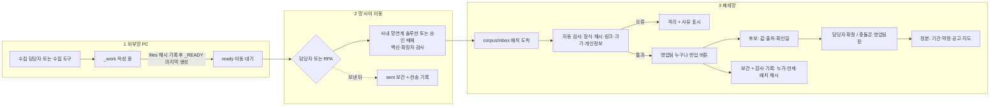

# planner 보고서 (자동 보존)

> SubagentStop 훅이 에이전트의 최종 메시지를 그대로 저장했다(2026-11-11 1014 KST, agentId ace93f4b7da7a5977). 에이전트 출력이므로 사용자 결정이 아니다. 지시 내용·주제는 이 파일에 없다 — 필요하면 handoff/NEXT.md 항목이나 커밋 메시지로 찾는다.

---

# NEXT 76 기획: 외부망에서 폐쇄망으로 자료를 들여오는 경로

## 1. 대상·방법·못 본 것

**읽은 것**
- `handoff/NEXT.md` 35·56·70·71·72·74·76
- `collector/SCHEMA.md`
- `server/csv_import.py`의 HEADER_MAP
- `InboxController`·`InboxService`·`BatchSchema`
- security `2026-11-11_0942`(S1~S11, C1~C8)
- data-auditor `2026-11-11_0912`·`_1008`

**못 본 것**
- security `2026-11-11_0925`
- 짝 파일 `contract/batch_schema.py`(BatchSchema 주석에 언급된 Python 원본)
- 설정에 적힌 inbox·batches 실제 경로
- `frontend/js/logic.js`의 CSV_HEADERS
- 56 planner 원 보고서(NEXT 요약만 봄)

**코드에서 확인한 사실 5가지 (기획 전제에 영향)**
- **F1.** 지금 반입은 `institutions.csv`를 기관 정본에 이름 키로 바로 덮어쓴다(`InboxService.java:173-182`). 이미 정한 "반입값은 후보, 사람이 고친 값은 덮지 않음"과 **정면으로 충돌**한다.
- **F2.** manifest v1의 `records`는 공고 전용이다. 필수 필드가 notice_id·title·institution·evidence라서(`BatchSchema.java:43`) 기관장·임직원 수·보관은행은 담을 자리가 없다.
- **F3.** 반입 대기 배치 목록을 보여 주는 API·화면이 없다. 프런트에 `/inbox` 호출이 0건이라, 지금은 batch_id를 알아야만 반입할 수 있다.
- **F4.** 미등록 파일·링크·해시를 검사하지 않는다(S5). 같은 batch_id로 다시 반입하면 보관본을 지우고, 첨부도 덮어쓴다(S9).
- **F5.** 외부는 기관 ID를 지어내지 않는다(SCHEMA ⑩-2). 그런데 security C3은 이름을 키로 쓰지 말라고 하고, 56의 md 파일 이름 규칙은 `{기관ID}_{확인일}.md`다. **세 규칙이 서로 맞물려 충돌한다.**

## 2. 요구 요약

**확정된 전제**
- 반입 버튼은 영업팀 누구나, 반입값은 '후보', 사람이 확정한다(72, 사용자 11-11).
- 사람이 고친 값은 덮지 않는다. 값이 충돌하면 영업팀장이 해소하고, 자기가 낸 값은 자기가 해소할 수 없다(72).
- 기관장 정보는 이름·직위·취임일과 공개 보도의 학력·경력 요약까지, 항목 칸으로만 받는다. 자유 서술과 경조사는 받지 않는다. 열람은 영업팀 전원이다(72).
- 임직원·기관장 수집 범위: 제안 확정 기관과 입찰 1년 이내 기관부터, 결과가 나온 곳도 포함한다(72).
- 법원은 공탁금 보관은행 기준이고, 본원·지원·가정지원과 개원 예정 법원까지 지도에 올린다(72).
- 망 경계는 파일 단방향이고, 역방향 콜백은 금지한다(SCHEMA ⑩-5).
- 붙임 형식: 70·71은 HWPX·PDF(71은 xlsx·docx 추가), security C6 허용 목록에는 hwp도 있다.

**새로 정할 것**
- 망 사이 이동 수단과 그 주체
- 외부 PC의 위치·담당자
- 주기
- 기관을 어떻게 맞출지(F5)
- 계약 v2 여부
- 1단계 대상 자료

## 3. 용어 정의 후보

| 용어 | 후보 | 권장 |
|---|---|---|
| 배치 | ⓐ 수집 1회 = 폴더 1개(현 계약) ⓑ 하루치 묶음 ⓒ 출처 1곳 × 자료 종류 1개 × 수집 1회 | **ⓒ**: ⓐ에 종류 하나 조건을 더한 것 |
| 반입 | ⓐ 파일이 내부 inbox에 도착한 것 ⓑ 사람이 버튼을 눌러 후보로 등록한 것 ⓒ 후보가 정본으로 확정된 것 | **ⓑ**. ⓐ는 '도착', ⓒ는 '확정'으로 나눠 부른다 |
| 이동 완료 | ⓐ 외부에서 보낸 시각 ⓑ 내부에 `_READY` 파일까지 도착한 시각 | **ⓑ** |

## 4. 반입 대상 목록

주기는 모두 **후보**다. 출처의 공시 주기는 data-auditor 보고서를 따랐다.

| 자료 | 출처 사이트 | 형식 | 주기 후보 | 들어갈 자리 | 개인정보 |
|---|---|---|---|---|---|
| 금고 지정 공고 | eminwon(지자체 고시공고), 지자체 홈페이지, 나라장터 | manifest(records)+CSV+공고문 PDF/HWP | 주 1회 / 주 2회 / 매일 | 공고 일정(현 반입 경로), 지도 임박도, 75 | 공고문에 담당자 이름·전화가 있을 수 있음. 첨부도 개인정보 검사 필요 |
| 금고 결과·약정 | 지자체 결과 공고(eminwon·구청 고시공고), 기사는 보조 | manifest(새 종류)+원문 | 결과 시기(사례상 9~11월 심의)에는 주 1회, 그 외 월 1회 | 72 약정 기록, 73 입찰 결과(C8 충돌 처리) | 없음 |
| 법원 공탁금 보관은행 | 대법원 새소식 공고(hwp 첨부), law.go.kr 별표(법원 목록), 법원 사이트(소재지) | manifest(새 종류: 지정 1건에 여러 법원·시행일·종료일) | 월 1회 | 72 약정 기록·기관 운영 상태·개원 예정일, 75 | 없음 |
| 기관 기본정보·임직원 수 | 알리오(분기 공시)·data.go.kr 임직원수 파일, 클린아이(연 1회), org.go.kr 정원 엑셀, 행안부 인사통계(연 1회), 지자체 정보공개 | manifest(새 종류)+원본 CSV·xlsx | 출처 공시 주기에 맞춤(분기·연 1회) | 72(정원/현원·기준일·범위 표기를 출처대로), 56 요약서 | 없음(집계값) |
| 기관장 프로필 | 기관 홈페이지 기관장 소개, 공개 보도 | manifest(새 종류, 허용 항목만) | 월 1회 + 선거·인사 뒤 수시 | 72 C5 별도 표·별도 API | **있음**: 다른 자료와 섞지 않고 배치를 따로 만든다 |
| RFP·붙임서류 | 공고 첨부(eminwon·나라장터) | PDF·HWP·HWPX | 공고와 같은 배치 | `corpus/rfp`·rfp_path, 74. 71(내부 업로드 원본 보관)과는 다른 경로 | 연락처가 있을 수 있음 |
| 기관 정보 요약 md | 기관 웹사이트 → md(56 Q2) | md(값마다 출처 URL·확인일) | 월 1회 / 분기 | 56 기관 정보 요약서 | 기관장 내용은 md에 넣지 않고 기관장 프로필 배치로 분리 |
| 주소→좌표 | 모름, 확인 필요(외부 지오코딩 서비스와 이용 조건) | manifest(새 종류) | 신규 기관이 생길 때 | 75 건물 단위 표식 | 없음 |

## 5. 3구간 흐름과 폴더 규칙



**폴더 규칙(제안)**
- **외부 루트**: `<드라이브>\GGInbox\`. 드라이브와 PC는 사용자가 정한다.
  - `_work\<batch_id>\`: 작성 중. 여기서는 옮기지 않는다.
  - `ready\<batch_id>\`: 이동할 대상.
  - `sent\YYYY-MM\<batch_id>\`: 보낸 것을 보관.
  - `log\transfer_YYYY-MM.csv`: batch_id·manifest 해시·보낸 시각·보낸 사람(사번).
- **이름**: 기존 `YYYY-MM-DD_HHmm_<source_slug>`를 유지한다. slug는 `<출처>-<종류>` 꼴이다(예: `eminwon-notice`, `alio-headcount`, `scourt-custody`, `web-head-profile`, `web-org-summary`). 같은 분에 같은 slug가 생기면 수집 쪽이 1분 뒤로 미룬다. S9의 덮어쓰기를 막기 위해서다.
- **배치 단위**: 출처 1곳 × 종류 1개 × 수집 1회. 기관장 프로필은 반드시 단독 배치로 만든다.
- **완료 표시**: 마지막에 `_READY`를 만들고, 안에 manifest의 sha256을 적는다. 내부는 `_READY`가 없는 배치를 아직 복사 중으로 보고 목록에서 뺀다.
- **중복 방지 세 겹**:
  1. batch_id 유일 + manifest 해시 원장. 같은 id에 다른 해시면 거부한다.
  2. 레코드 키: 공고는 (source.slug, notice_id), 새 종류는 종류별 키(백엔드가 정한다).
  3. 파일 sha256이 같으면 다시 저장하지 않는다.
- **망 사이 포장**: 폴더를 그대로 보내거나 배치당 zip 1개(`<batch_id>.zip` + `.sha256`). 망연계 솔루션이 폴더나 zip을 받는지는 모르므로 정보보호에 확인한다. zip이면 내부에서 ZipGuard를 재사용한다.
- **내부**: `corpus/inbox/<batch_id>/`
  - 처리 뒤에는 `batches/<batch_id>/`로 옮기고, 덮지 않고 접미사를 붙인다.
  - 실패하면 `inbox/_quarantine/<batch_id>/`에 사유와 함께 둔다.

## 6. 이동 주체 비교

| 주체 | 비용 | 위험 | 되돌리기 | 전제 조건 |
|---|---|---|---|---|
| 담당자 수동 | 낮음(사람 시간: 주기 × 건당 몇 분, 실측 없음) | 빠뜨림·순서 실수, 담당자 부재 | 매우 쉬움 | 반입 경로(망연계·매체) 허가, 담당자와 대리 지정 |
| RPA | 모름(도구 보유 여부에 달림) | RPA 계정 권한 남용, 실패를 모르고 지나감 | 쉬움(수동으로 되돌림) | 회사 RPA 도구, RPA 계정의 망연계 사용 허가, 실패 알림 |
| 사내 망연계 솔루션 | 모름(이미 있으면 거의 0) | 솔루션 제약(크기·확장자·결재)이 계약을 좌우 | 쉬움 | 솔루션 존재 여부와 이용 절차 |
| 장기 통합 시스템 | 높음(수집기 상시 운영·감시·전송 자동화·내부 자동 감지) | 범위가 커지고, 망 경계 설계가 잘못되면 되돌리기 어려움 | 어려움 | 위 셋이 안정된 뒤, 정보보호 승인 |

망연계 솔루션은 '운반 수단'이고, 담당자·RPA는 '누르는 주체'다. 그래서 둘은 조합해서 쓴다(예: 담당자가 솔루션으로 보냄).

**단계별 권장**
- **1단계**: 담당자 수동 + 공식 반입 경로(솔루션이 있으면 그것) + 내부 목록·검사·반입 화면. 대상은 공고·결과·보관은행.
- **2단계**: 외부 쪽 전송만 RPA로 바꾼다. 내부는 `_READY`를 자동으로 감지해 목록에 띄우기만 하고, 반입 버튼은 계속 사람이 누른다. 기관 정보·임직원·md를 추가한다.
- **3단계**: 통합 시스템(수집 일정·전송·검사·후보 확정·감사를 한 화면에서). 기관장 프로필은 정보보호 회신 뒤 시작한다.

**권장 이유**
- 확정 결정("사람이 반입·확정")에 맞는다.
- 자동화가 늘어도 정본에 쓰는 일은 늘 사람이 한다.
- 1단계는 계약을 바꾸지 않고도 공고 반입을 시작할 수 있다. 단, 내부 반입은 S1·S4 패치 뒤에 한다.

## 7. 계약(`collector/SCHEMA.md`) 변경 제안

변경은 제안만 하고, 확정하지 않는다.

**선택지**

| 안 | 내용 | 장점 | 위험 |
|---|---|---|---|
| A | v1에 선택 필드만 추가 | 버전 유지 | 새 종류가 공고 필수 필드에 막힌다. 옛 서버는 모르는 필드를 조용히 무시해 '반입된 줄 아는' 손실이 생긴다(§⑨ 취지에 어긋남) |
| **B (권장)** | v2: `kind` 필수, 종류별 필수 필드, CSV 선택화 | v1 배치는 그대로 유효(`kind` 없음 = notice). 의미 변경을 버전으로 드러낸다 | Java·Python 검사기 두 벌을 같이 고쳐야 한다 |
| C | 종류별 별도 계약 문서 | 독립적 | 공통 규칙(해시·폴더·`_READY`)이 갈라진다 |

**B안에서 더할 것**
- **manifest 최상위**
  - `kind` 필수: notice / contract_result / court_custody / headcount / head_profile / org_summary / geocode
  - `files[]` 필수: path·sha256·bytes. 배치 안의 모든 파일(CSV 포함)을 등록하고, 미등록 파일은 거부한다. `_READY`만 예외.
  - `collector.host_label`: PC 별칭. 실명은 넣지 않는다.
- **새 종류 레코드 공통 틀**
  - `institution`: name_ko·type·region_code·sub_region_code·address 선택
  - `evidence`: url·captured_at·note
  - 값마다 출처 URL·확인일·확인 상태(56 규격)
  - 모르는 값은 키를 생략한다(추측 금지 유지).
- **종류별 핵심**
  - headcount: 정원·현원·기준일·범위 표기(소방 포함 여부 등)
  - head_profile: 허용 항목만(성명·직위·재임 시작/종료·학력 요약·경력 요약 항목). 자유 서술 키는 거부한다.
  - court_custody: 지정 1건에 법원 여러 곳·은행·시행일·종료일·공고일
- **institutions.csv**: v2에서는 notice에서만 필수, 다른 종류에서는 없어도 된다. 선택 열은 `운영상태`·`개원예정일`·`주소`·`기관ID`이고, `기관ID`는 질문 U6에서 반출을 허용할 때만 쓴다. 지금 두 소비자는 모르는 열을 무시하므로 열 추가 자체는 안전하다.
- **md 첨부**: `files/org/<slug>.md`. 머리에 기관명·지역코드·확인일·출처 목록을 두고, 인물 정보는 넣지 않는다.
- **의미 변경 명시**: 반입은 후보 등록이고 정본을 덮지 않는다(F1). 이건 망 안의 처리 규칙이지만, 계약 §⑥에 적어 둬야 수집 쪽이 "빈칸=무해"라는 오해를 하지 않는다.

## 8. 사용자에게 물을 질문 (업무 언어)

각 질문에 묻는 이유와 선택지·권장을 함께 적었다.

- **U1. 인터넷 PC 자료를 업무망으로 옮기는 회사 공식 방법이 있나요?** 은행마다 인터넷망 파일을 업무망으로 넘기는 전용 프로그램(망연계)이나 승인된 USB 절차가 있습니다. 어느 쪽이냐에 따라 한 번에 옮길 수 있는 크기·파일 종류·결재가 정해집니다.
  - (가) 망연계 프로그램이 있다(이름과 결재 여부도 알려 주세요)
  - (나) 승인된 USB만 된다
  - (다) 모른다 → 정보보호에 묻는다
  - 권장: 모르면 (다)
- **U2. 수집 자료를 쌓아 둘 인터넷 PC와 담당자는 누구인가요?** 쌓는 곳이 하나로 고정돼야 빠짐없이 옮길 수 있습니다.
  - (가) 지금 쓰는 영업팀 인터넷 PC + 담당자 1명과 대리 1명
  - (나) 별도 전용 PC
  - 권장: 1단계는 (가)
- **U3. 얼마나 자주 옮겨 올까요?** 공고를 놓치는 위험과 담당자 수고가 맞바뀝니다.
  - (가) 매일
  - (나) 주 2회
  - (다) 주 1회 + 결과 발표 시기(가을)와 임박 기관은 수시
  - 권장: (다)
- **U4. 회사에 반복 작업을 대신 눌러 주는 자동화(RPA) 도구가 있나요?** 2단계 자동 전송이 가능한지가 이 답으로 정해집니다.
  - (가) 있다(이름)
  - (나) 없다
  - (다) 모른다
- **U5. 업무망으로 옮길 때 팀장 결재 같은 승인 단계가 필요한가요?** 반입 버튼은 이미 영업팀 누구나로 정했고, 이건 망을 건너는 순간의 승인입니다.
  - (가) 회사 절차대로만(별도 승인 없음)
  - (나) 영업팀장이 보낼 묶음을 승인
  - 권장: (가). 사람 확정 단계가 이미 따로 있기 때문입니다.
- **U6. 업무망의 기관 목록(번호·이름·지역만)을 인터넷 PC로 내보내도 되나요?** 수집한 자료를 어느 기관 것인지 정확히 맞추려면 번호표가 필요합니다. 못 내보내면 이름+지역으로 맞추고, 애매한 건 사람이 고릅니다.
  - (가) 내보내도 된다
  - (나) 안 된다
  - (다) 정보보호에 묻는다
  - 권장: (다). 회신 전에는 이름+지역으로 맞춘다.
- **U7. 1단계에 어떤 자료부터 들여올까요?**
  - (가) 입찰 공고·결과·법원 보관은행
  - (나) 기관 정보·임직원 수
  - (다) 전부
  - 권장: (가). 지도 임박도에 바로 쓰이기 때문입니다.

**정보보호 부서에 물을 것**

| # | 질문 |
|---|---|
| I1 | 공식 반입 경로(망연계 솔루션 이름·파일 크기·확장자 제한·결재·백신 검사) |
| I2 | 폴더를 그대로 보낼 수 있는지, zip 압축본을 허용하는지 |
| I3 | 허용 확장자: pdf·hwp·hwpx·csv·md·json·xlsx 각각 |
| I4 | RPA 계정이 망연계를 쓸 수 있는지, 사람 계정만 되는지 |
| I5 | USB 반입 허용 여부와 절차 |
| I6 | 내부 공개 정보(기관 번호·이름·지역)를 외부로 내보내는 것 허용 여부 |
| I7 | 기관장 공개 정보 수집의 처리 근거·보존 기간·파기 방법(35와 연결) |
| I8 | 외부 PC 보안 기준(전용 여부, 수집 도구 설치, 저장 폴더 암호화) |
| I9 | 반입 기록(누가·언제·무엇을)의 보존 기간 |
| I10 | 솔루션이 파일을 바꾸는지(파일명·확장자 변환, 무해화). 바꾸면 해시 대조가 깨진다 |

## 9. NEXT 76 갱신 문안 (3줄)

```
### 76. 외부망→폐쇄망 자료 반입 경로 — **planner 기획 완료(11-11), 사용자 U1~U7·정보보호 I1~I10 답 대기** [담당: 사용자 → security → backend-dev]
- **현재**: 3구간(외부 GGInbox _work/ready/sent → 망연계 → inbox·검사·후보 반입), 배치=출처×종류×1회·`_READY`+sha256·중복 3겹, 단계 권장(1 수동+공고·결과·보관은행 / 2 RPA 전송+자동 감지 / 3 통합), 계약 v2(kind 필수·files[] 해시·CSV 선택화) 제안. 발견: 현 반입은 정본을 이름 키로 덮어써 '후보' 결정과 충돌(F1), 반입 대기 목록 API·화면 없음(F3), 외부의 기관 ID 부재와 C3·56 md 이름 충돌(F5).
- **다음 한 걸음**: pm이 U1~U7을 사용자에게, 사용자가 I1~I10을 정보보호에 묻는다 ∥ backend S1·S4 패치(72와 같은 패치, 지금 가능). 자세히: handoff/agents/planner/2026-11-11_* (이 보고서), collector/SCHEMA.md, security 0942 C6.
```

## 10. 이관 메모

- **[이관: 백엔드]** 할 일과 판단할 일:
  - S1·S4 패치(반입 가드, 트랜잭션이 실제로 걸리게)는 지금 할 수 있다.
  - 반입 결과를 정본 직행에서 후보 표로 바꿔야 한다(F1). 후보 저장 구조와 기관 맞춤 규칙(이름+지역, 애매하면 매칭 대기)을 설계한다.
  - 반입 대기 목록 API(F3), 격리 폴더, 보관본을 덮지 않기(S9), 반입 해시 원장, `_READY` 인식이 필요하다.
  - v2 검사기는 Java와 `contract/batch_schema.py`를 함께 고쳐야 한다. 이 파일이 실제로 있는지는 내가 못 봤다.
  - 기다리는 것: U6·I1·I2 답, 계약 B안 승인. 근거: `InboxService.java:173-182`, `BatchSchema.java:43`, security C3·C6.
- **[이관: 보안]** 검토할 것:
  - 단방향 유지, 외부 PC와 RPA 계정의 권한 범위, `_READY`·해시 위조 가능성
  - 기관장 배치를 따로 다루는 방식(C5·C6, 성명 칸만 개인정보 검사에서 제외)
  - hwp 허용 여부. 70·71은 HWPX·PDF뿐이고 C6에는 hwp가 있으며, 대법원 공고는 hwp다.
  - 기관 목록 반출(U6) 위험
  - 기다리는 것: I1~I10 회신. 근거: security 0942 S5·S9·C5·C6.
- **[이관: 디자인·프런트]** 반입 대기 목록·검사 오류·후보 확정 화면 규격을 만든다. 기다리는 것: 백엔드 API 설계. 근거: F3, 72 후보 확정 결정.
- **[이관: 데이터]** 종류별 레코드 키와 필수 값을 검수한다. 특히 지정 1건에 여러 법원이 묶이는 경우(서울동부·남부), 정원/현원의 범위 표기, 결과 미확인 6곳을 'notice/contract_result' 배치 첫 시험 대상으로 쓰는 것. 기다리는 것: v2 초안. 근거: data-auditor 0912 §5·§7, 1008 §9.

**관련 파일**
- `C:\github\GGReportAgent\collector\SCHEMA.md`
- `C:\github\GGReportAgent\kgi-ggreport-web\src\main\java\com\kbstar\kgi\ggreport\web\service\InboxService.java`
- `C:\github\GGReportAgent\kgi-ggreport-web\src\main\java\com\kbstar\kgi\ggreport\web\support\BatchSchema.java`
- `C:\github\GGReportAgent\kgi-ggreport-web\src\main\java\com\kbstar\kgi\ggreport\web\web\InboxController.java`
- `C:\github\GGReportAgent\handoff\agents\security\2026-11-11_0942_ae9df1a1.md`
- `C:\github\GGReportAgent\handoff\agents\data-auditor\2026-11-11_0912_aaebc3fc.md`
- `C:\github\GGReportAgent\handoff\agents\data-auditor\2026-11-11_1008_a7dd7839.md`
