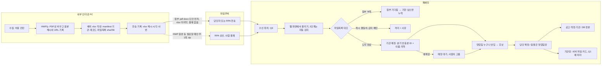

# planner 보고서 (자동 보존)

> SubagentStop 훅이 에이전트의 최종 메시지를 그대로 저장했다(2026-11-11 1101 KST, agentId a8859d270a356250f). 에이전트 출력이므로 사용자 결정이 아니다. 지시 내용·주제는 이 파일에 없다 — 필요하면 handoff/NEXT.md 항목이나 커밋 메시지로 찾는다.

---

# NEXT 76 재기획: 파일무버 제약에 맞춘 외부망→폐쇄망 반입 경로

## 1. 대상·방법·못 본 것

**읽은 것**
- NEXT 72·76
- planner 2026-11-11_1014 보고서(이전 76 기획)
- security 2026-11-11_1056 보고서
- 서버 코드는 grep으로만 확인했다. xlsx 읽기(POI·`XlsxBook`·`XlsxBookGuard`·`PoiLimitsConfig`)와 `ZipGuard`가 이미 있다. 서버가 배치 xlsx를 읽는 데 새 라이브러리는 필요 없다.

**못 본 것**
- `collector/SCHEMA.md` 본문은 다시 읽지 않았다. 이전 보고서의 요약을 그대로 썼다.
- security 0942 원문
- 파일무버가 파일을 어디로 내려 주는지, 파일을 바꾸는지(무해화·이름 변경)는 모른다. 확인이 필요하다.

## 2. 요구 요약

**확정된 전제**
- **72·76에서 정한 것**
  - 1단계부터 모든 종류를 반입한다.
  - 기관장 정보는 값마다 출처 URL과 확인일을 단다.
  - 반입 버튼은 영업팀 누구나 누른다. 반입값은 '후보'이고 사람이 확정한다.
  - 주기는 주 1회 + 수시, 담당은 1명 + 대리 1명이다. RPA가 있다.
  - 기관장 항목은 이름·직위·취임일·학력 요약·경력 요약이고, 열람은 영업팀 전원이다.
- **76 사용자 답(11-11)**
  - 망연계 프로그램은 파일무버이고 크기 제한은 없다.
  - 결재 없이 넘어가는 확장자는 docx·ppt·pdf·xlsx뿐이다.
  - 폴더째로는 못 보낸다. 단건 또는 zip으로 보낸다.
  - RPA 계정으로 전송할 수 있다.
  - 기관 목록은 내보낼 수 있지만 자주는 어렵다.
  - 기관장 정보의 수집 근거는 '기관영업 추진'이고 보존 기간은 '계속'이다.
  - DB 저장은 어렵다. 휴대폰번호 같은 정보는 보관하지 않는 쪽으로 간다.

**새로 정할 것**: ① 배치 포장 ② 도착 파일을 묶는 방법과 v1과의 관계 ③ 기관장 정보 저장 위치 ④ 기관 매칭 방법 ⑤ RPA 범위

## 3. 용어 정의 후보

| 용어 | 후보 | 권장 |
|---|---|---|
| 배치 xlsx | ⓐ 수집 결과 전체를 담은 엑셀 1개 ⓑ 기록 + 첨부 목록 + 해시를 담은 '송장' 엑셀 | **ⓑ**. 첨부 본문은 따로 보낸다. |
| 도착 완료 | ⓐ 배치 xlsx가 도착함 ⓑ xlsx에 적힌 첨부가 모두 도착하고 해시까지 맞음 | **ⓑ**. ⓐ 상태는 '첨부 기다림'이라 부른다. |
| 기관장 정보 '보관' | ⓐ 업무 DB 칸에 저장 ⓑ 서버 파일 저장소에 문서로 저장 ⓒ 반입 원본만 보존 | Q1 답에 따라 정한다(4절 ③). |

## 4. 선택지 비교와 권장안

### ① 배치 포장

| 안 | 결재 빈도 | RPA 자동화 | 무결성 | HWP 공고문 | 위험 | 되돌리기 |
|---|---|---|---|---|---|---|
| **(가) 배치 xlsx 1개 + 첨부 pdf·docx 단건** | 0회(HWP 원본만 예외) | 끝까지 자동 | xlsx의 파일목록 시트에 첨부별 sha256을 적는다. xlsx 자신의 해시는 외부 전송 기록과 대조한다. | 외부에서 PDF로 바꿔 보낸다. 원본 HWP의 sha256과 URL은 xlsx에 남긴다. | **결재 우회로 볼 소지가 있다(Q2).** 엑셀에서 직접 고치면 날짜·앞자리 0이 바뀌므로 xlsx는 도구로만 만든다. 셀 수식 주입도 막아야 한다. | 쉽다 |
| (나) 배치마다 zip 1개 | 주 1회 + 수시마다 매번 | 상신까지만 자동이고 결재는 사람이 한다 | zip 안에 manifest를 그대로 넣는다(v2 그대로). `ZipGuard`를 재사용한다. | 원본 HWP가 그대로 들어간다 | 결재가 밀리면 공고를 놓친다. 담당자 부담이 생긴다. | 쉽다 |
| (다) 혼합: 평소엔 (가), HWP 원본·md·json이 꼭 필요할 때만 주 1회 zip | 0~1회/주 | 평소엔 자동 | (가)와 (나)를 모두 지원해야 한다 | 원본이 필요하면 다음 zip에 담는다 | 검사기를 두 벌 운영한다 | 보통 |

**권장: (다), 단 1단계는 (가)만 쓴다.**
- 지도 임박도 판단에 HWP 원본은 필요 없다. PDF + 원본 URL + 원본 해시면 출처 추적이 된다.
- zip 경로는 원본 보존 요구가 생기면 연다.
- 단, Q2(xlsx 운반이 규정상 괜찮은지)가 '안 된다'면 (나)로 바꾼다.

### ② 내부 반입 쪽 변화

**파일명 규칙**
- 배치 xlsx: `GG_<YYYYMMDD-HHmm>_<출처-종류>_00.xlsx`
- 첨부: `GG_<YYYYMMDD-HHmm>_<출처-종류>_01.pdf`, `_02.docx` 순으로 번호를 붙인다.
- 영문·숫자만 쓴다. 한글 원래 이름은 xlsx 파일목록 시트에 적는다. 파일무버가 한글을 깨뜨리거나 이름을 바꿀 수 있어서다.

**배치 xlsx 시트 구성**
- `manifest`: kind·batch_id·수집 시각·PC 별칭
- `기관`
- `레코드`: 값마다 출처 URL·확인일
- `파일목록`: 번호·원래 이름·sha256·크기·원본 형식(예: hwp→pdf)·원본 해시

**도착 완료 판정**
- 첨부를 먼저 보내고 xlsx를 마지막에 보낸다. xlsx가 이전 계약의 `_READY` 역할을 한다.
- 순서가 뒤바뀌어 도착하면 '첨부 기다림'으로 둔다.
- 일정 기간이 지나도 다 오지 않으면 '누락'으로 표시한다. 기간 값은 팀이 정한다.

**SCHEMA v1과의 관계: 권장은 '내용 계약은 v2 하나, 포장은 둘'**
- v2는 이전 기획의 B안이다(kind 필수·files[]·종류별 필수 필드).
- 포장 1: v1·v2 폴더. 개발·시험용이고 기존 테스트를 유지한다.
- 포장 2: xlsx 묶음. 운영용이다.
- v1 폴더 반입은 하위 호환으로 그대로 둔다. 새 종류는 v2만 받는다.
- 대안 'xlsx 전용으로 완전 대체'는 기존 반입 테스트와 수집기 계약을 버리는 일이라 되돌리기 어렵다.

**내부 진입 방식**
- 1단계 기본은 '웹 화면에서 xlsx + 첨부 올리기 → 대기 목록'이다. 파일무버가 어디에 내려 주든(개인 PC 또는 공유폴더) 이 방식은 성립한다.
- 서버 폴더 자동 감지는 Q3 답이 '서버 폴더'일 때 2단계에서 한다.

### ③ 기관장 정보 저장 위치 (Q1 답 전 잠정)

| 안 | 영업팀 열람 | 출처 표시 | 감사 | 보존 '계속'·이력 | 후보→확정 | 위험 |
|---|---|---|---|---|---|---|
| A 업무 DB 별도 표(72 C5 원안) | 좋음 | 좋음 | 좋음 | 추가 전용 이력 | 자연스러움 | 사용자 답 'DB 어려움'과 충돌 |
| **B 서버 파일 저장소에 기관별 '기관장 카드' 파일(xlsx). 화면은 읽어서 보여 주기만 하고 내려받기는 막는다. 갱신은 덮지 않고 날짜를 붙인 새 파일로 한다.** | 좋음 | 파일 안의 칸 | 열람 기록은 기존 접근 이력에 남긴다(값은 남기지 않음) | 날짜별 파일로 이력이 남는다 | 확정 = 담당자가 후보를 새 카드로 승격. 충돌은 영업팀장 | 파일이어도 법상 '개인정보파일'로 볼 수 있어 **규정 회피가 아니다** → 정보보호 확인 필요 |
| C 반입 원본 xlsx를 그대로 열람 | 보통(최신값 찾기 어려움) | 원문 그대로 | 보통 | 원본이 쌓인다 | **확정 단계가 없어** 확정 결정과 어긋난다 | 낮음 |

**권장: Q1 답 전에는 B.**
- Q1이 '절차가 오래 걸린다'라면 B로 시작하고 나중에 A로 옮긴다.
- Q1이 '정책상 금지'라면 B도 정보보호의 허락을 받아야 한다.

**휴대폰번호 등 비수집은 두 겹으로 막는다**
1. 수집 도구와 xlsx 레코드 시트는 허용 칸만 둔다. 자유 서술 칸은 없다.
2. 내부 검사에서 휴대폰·이메일·주민번호 패턴이 보이면 그 배치를 격리한다.
- 공고문 첨부에 있는 공무원 사무실 전화의 처리는 security 판단으로 넘긴다.

### ④ 기관 목록 반출이 제한적일 때의 매칭

| 안 | 자동 매칭률 | 비용 | 위험 |
|---|---|---|---|
| a 반출 없이 이름+지역만 | 낮음(동명·개칭) | 0 | 사람이 고를 일이 많다 |
| **b 분기 1회 반출본(기관ID·이름·지역코드만) + 이름·지역 매칭** | 높음 | 분기 1회 반출 | 반출본 이후 생긴 기관은 a와 같다 |

**권장: b.**
- 외부에서 적은 ID는 '참고 ID'로만 쓴다. 내부에서 ID와 이름+지역이 모두 맞을 때만 자동으로 매칭하고, 하나라도 다르면 '매칭 대기'로 두고 사람이 고른다.
- 반출 주기는 분기 1회를 기본으로 하고, 기관이 대량으로 추가되면 1회 더한다.

### ⑤ RPA 범위

| 안 | 내용 | 비고 |
|---|---|---|
| **R1 (2단계 권장)** | 외부 PC에서 배치 xlsx와 첨부를 파일무버로 올린다. 결재 대상(zip·hwp)은 RPA가 상신만 하고 사람이 결재한다. | 확정 결정('사람이 반입·확정')과 충돌하지 않는다 |
| R2 | R1에 더해, 내부 수신 위치의 파일을 대기 목록에 올리는 일까지 한다 | Q3 답이 '공유폴더'이고 내부 RPA가 허용될 때만. 반입 버튼은 계속 사람이 누른다 |
| R3 | 웹 수집까지 RPA로 한다 | 범위가 커진다. 76 밖이다. |

1단계는 사람이 전송한다.

### 흐름도



## 5. 결정이 필요한 질문 (사용자용)

**Q1. 기관장 정보는 'DB 저장이 어렵다'고 하셨는데, 어떤 뜻인가요?**
기관장 이름·학력·경력을 시스템 안 어디에 둘지가 이 답으로 정해집니다. 답에 따라 파일로 시작할지, 처음부터 DB로 갈지, 정보보호 허락부터 받을지가 달라집니다.
- (가) 회사 정책상 개인정보를 업무 DB에 두면 안 된다
- (나) 둘 수는 있지만 등록·심사 절차가 오래 걸린다
- (다) 휴대폰번호 같은 일부 항목만 문제다
- (라) 모른다 → 정보보호에 묻는다
- 권장: 모르면 (라). 그동안은 파일 보관으로 준비합니다.

**Q2. 수집 결과를 '엑셀 파일'에 담아 결재 없이 보내는 방식이 회사 규정상 괜찮을까요?**
같은 내용을 csv로 보내면 결재 대상인데, 엑셀(xlsx)에 담으면 결재 없이 넘어갑니다. 회사가 이를 '결재 우회'로 볼 수 있습니다. 괜찮다면 매번 결재 없이 RPA로 자동 전송할 수 있습니다. 안 된다면 묶음마다 zip으로 결재를 받아야 해서, 주 1회 + 수시마다 결재가 생깁니다.
- (가) 정보보호에 확인한 뒤 쓴다
- (나) 문제없다고 알고 있다
- (다) 처음부터 결재받는 zip으로 간다
- 권장: (가)

**Q3. 파일무버로 보낸 파일은 업무망 어디에 도착하나요? 도착할 때 파일 이름이나 내용이 바뀌나요?**
도착 위치가 내부 자동화 범위를 정합니다. 파일이 바뀌면 '보낸 파일과 같은지' 확인하는 방법을 바꿔야 합니다.
- 도착 위치: (가) 받는 사람 PC의 폴더 (나) 공유폴더나 서버 (다) 모른다
- 파일 변형(무해화·이름 변경): 있다 / 없다 / 모른다
- 권장: 모르면 Q2와 함께 정보보호에 묻습니다. 그동안은 화면에서 직접 올리는 방식으로 준비합니다.

**정보보호에 함께 물을 것**(이전 I1~I10을 줄인 목록)
- I-a: Q1·Q2·Q3
- I-b: 기관장 정보를 서버 파일로 두는 경우에도 개인정보파일 등록 대상인지
- I-c: 업무망→인터넷 기관 목록 반출 주기(분기 1회가 가능한지)와 방법

## 6. NEXT 76 갱신 문안 (3줄)

```
### 76. 외부망→폐쇄망 자료 반입 경로 — **파일무버 제약 반영 재기획 완료(11-11), 사용자 Q1~Q3(정보보호 문의 포함) 답 대기** [담당: 사용자 → security → backend-dev]
- **현재**: 운반=배치 xlsx(manifest·기관·레코드·파일목록 sha256, 결재 불필요)+첨부 pdf·docx 단건, 파일명 GG_<시각>_<출처-종류>_NN, xlsx 마지막 도착=완료 판정, HWP는 PDF 변환+원본 해시·URL(원본 필요 시 주1회 zip 결재). 내용 계약 v2 하나·포장 둘(폴더=시험, xlsx=운영), v1 폴더 병행. 기관장=DB 밖 서버 파일 카드(잠정, Q1)·허용 칸+금지 패턴 격리, 매칭=분기 반출본 ID 참고+이름·지역·애매하면 사람, RPA=2단계 외부 전송까지(결재는 사람).
- **다음 한 걸음**: 사용자 Q1(DB 어려움의 뜻)·Q2(xlsx 운반 규정)·Q3(도착 위치·파일 변형)을 정보보호에 확인 → security 설계 검토 → backend(xlsx 송장 검사기·대기 목록·후보 표). 자세히: handoff/agents/planner/ 11-11 76 재기획 보고서, 이전 1014.
```

## 7. 이관 메모

- **[이관: 보안]** 다음을 검토한다.
  - xlsx 운반이 결재 우회로 해석될 위험
  - 배치 xlsx의 셀 수식 주입, 숨김 시트, 외부 링크
  - 파일무버가 파일을 무해화하면 해시 대조가 깨지는 문제와 그때의 대안(값 단위 대조)
  - 기관장 카드 파일의 접근 통제·내려받기 금지·열람 기록
  - 서버 파일로 두어도 개인정보파일에 해당하는지(I-b)
  - 공고문 PDF 속 공무원 사무실 전화의 처리
  - 금지 패턴 격리 규칙
  - 기다리는 것: Q1~Q3 답
  - 근거: 이 보고서 ①③, security 0942 C5·C6, 1056 #1~#4
- **[이관: 백엔드]** 다음을 설계한다.
  - xlsx 송장 검사기(v2 내용 규칙 공유, 기존 `XlsxBookGuard`·`PoiLimitsConfig` 재사용 검토)
  - 도착 상태(첨부 기다림·누락·격리·도착 완료)
  - 웹 올리기 → 대기 목록 API
  - 후보 표와 매칭 대기
  - 72 C5 '기관장 별도 표'는 Q1 답 전까지 설계에서 보류하고, 파일 카드 안을 검토
  - v1 폴더 반입은 그대로 둔다
  - 1056 #1·#2 패치는 지금 할 수 있다
  - 기다리는 것: Q1~Q3, security 검토
  - 근거: ②③④
- **[이관: 데이터]** 배치 xlsx 레코드 시트의 종류별 필수 칸과 키를 검수한다. 범위는 공고·결과·보관은행·임직원·기관장이다. 특히 지정 1건에 법원 여러 곳이 묶이는 경우를 행으로 어떻게 펼칠지 본다. 기다리는 것: v2 초안. 근거: data-auditor 0912·1008.
- **[이관: 디자인·프런트]** 다음 화면의 규격을 만든다. 기다리는 것: 백엔드 API. 근거: 흐름도 C2~C9.
  - 올리기와 대기 목록(도착 상태 4종)
  - 매칭 대기에서 고르기
  - 기관장 카드 읽기 전용 표시

**관련 파일**
- C:\github\GGReportAgent\handoff\NEXT.md (72·76)
- C:\github\GGReportAgent\handoff\agents\planner\2026-11-11_1014_ace93f4b.md
- C:\github\GGReportAgent\handoff\agents\security\2026-11-11_1056_aa60ed44.md
- C:\github\GGReportAgent\collector\SCHEMA.md
- C:\github\GGReportAgent\kgi-ggreport-web\src\main\java\com\kbstar\kgi\ggreport\web\docfill\XlsxBook.java
- C:\github\GGReportAgent\kgi-ggreport-web\src\main\java\com\kbstar\kgi\ggreport\web\docfill\ZipGuard.java
